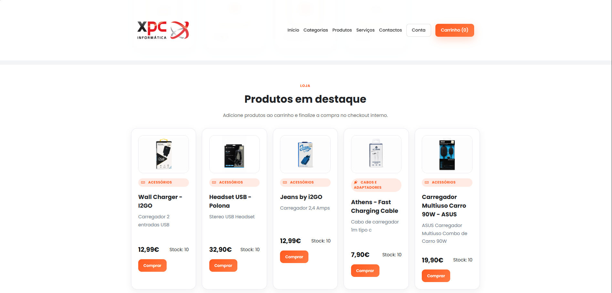

# XPC Informática

A PHP computer-store and technical-services website with a product catalogue, shopping cart, order checkout, customer accounts and an administration panel. Administrators manage products, categories, stock, orders, services and users.

## Preview



Portfolio screenshot of the earlier storefront design. The current PHP application lives in `site_vendas/`; run it locally to explore its interactive features.

## Run locally

Requires **PHP 8.0+** and **Composer**. From this repository's root:

```bash
cd site_vendas
composer install
php -S localhost:8000
```

Open `http://localhost:8000/`. The PHP process needs write access to `site_vendas/storage/` for the JSON store and uploads.

## Try it

1. Browse categories and products.
2. Register or sign in, add products to the cart and adjust quantities.
3. Complete checkout to create an order and update stock.
4. Review orders in the customer area, or submit a technical-service request.
5. An administrator can open `/admin/` to manage the store.

## Relevant details

- Uses PHP, HTML, CSS and JavaScript, with PHPMailer for email.
- Data is stored in `site_vendas/storage/database.json`; the current data layer does not use MySQL or SQLite.
- Checkout records orders internally. There is no online payment gateway.
- The initial administrator is defined by `ADMIN_EMAIL` and `ADMIN_DEFAULT_PASSWORD` in `site_vendas/inc/config.php`. These seed a new data store; changing the constants does not reset existing accounts.
- Treat this as a local demonstration. The bundled data and seed administrator need review before deployment.
- See the [application setup notes](site_vendas/README.md) for email configuration and data handling, and [LICENSE](LICENSE) for licensing.

Created by **Quévin Tavares**.
